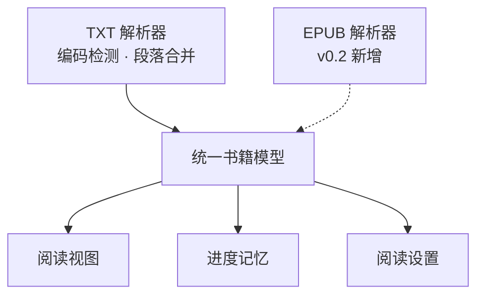

# 电子书阅读器 · 产品设计文档

> 版本 v0.1（MVP）｜状态：待开发｜更新：2026-11-09｜格式范围：先 TXT，后续 EPUB

## 1. 背景与真正目标

一句话：**做一个本地、无后端、能顺畅读完一本 TXT 并记住进度的阅读器**，同时保证以后加 EPUB 只换解析层、不动阅读层。

目标不是「功能齐全的阅读器」，而是交付并验证一条最小阅读闭环：

打开本地 TXT → 正确解码与排版 → 连续阅读 → 关闭后重开自动回到上次位置。

**非目标**

- 不验证 EPUB / PDF 的阅读体验（v0.2 之后的事）
- 不做多端同步、账号体系、服务端
- 不做内容管理（书架、书城、标签）
- 不做笔记、高亮、书摘、搜索、TTS、AI 摘要

## 2. 用户与场景

| 项 | 内容 |
|---|---|
| 使用者 | 作者自用，单机、单浏览器 |
| 主要读物 | 中文 TXT 小说 / 长文；常见 GBK、ANSI 编码；硬换行、无章节元数据 |
| 运行环境 | 桌面浏览器，本地文件，离线可用 |
| 关键场景 | 读长篇 → 中途关掉 → 隔天重新打开同一文件，接着读 |

> 口径澄清：v0.1 的「重开恢复」= 重新选择同一个文件后自动定位到上次位置，**不是**自动加载上一本书。文件本身不落库。

## 3. 产品原则

| 原则 | 含义 | 代价 / 取舍 |
|---|---|---|
| 闭环优先 | 只做「读完一本书」链路上的功能 | 目录树、书架一律延后 |
| 本地优先 | 文件不上传，进度存本地 | 放弃云同步与多端 |
| 格式隔离 | 解析层输出统一书籍模型 | 多一层抽象，换 EPUB 时 UI 零改动 |
| 可回滚 | 一次改动一个 commit + 测试全绿 | 遵守仓库 `AGENTS.MD` |

## 4. 版本路线

| 版本 | 范围 | 退出条件 |
|---|---|---|
| v0.1 MVP | 本地 TXT 阅读闭环 + 解析层解耦 | 3 本真实 TXT 走通闭环，测试全绿 |
| v0.2 | 新增 EPUB 解析器、目录树、进度模型兼容 | UI 层零改动即可读 EPUB |
| v0.3+ | 笔记 / 高亮、搜索、书架（按需） | 暂不排期 |

## 5. v0.1 功能清单

### 5.1 必做功能

| # | 功能 | 说明 | 验收要点 |
|---|---|---|---|
| F1 | 打开本地 TXT | 选择或拖入单个 `.txt` 文件 | 选完直接进入阅读视图 |
| F2 | 编码检测与切换 | 自动识别 UTF-8 / UTF-8 BOM / GBK；猜错可手动切换 | GBK 中文书不乱码 |
| F3 | 段落规范化 | 合并硬换行、按空行分段、保留段首缩进 | 不出现「一行一段」或一整坨 |
| F4 | 阅读视图 | 连续滚动、字号 3 档、行距 2 档、白天 / 夜间主题 | 设置即时生效且重启后保留 |
| F5 | 进度记忆 | 按字符偏移自动保存，重开同一文件自动恢复 | 刷新或重开，位置一致 |
| F6 | 线性跳转 | 按百分比跳转（不做目录树） | 跳到 50% 位置正确 |
| F7 | 解析层解耦 | 解析器输出统一书籍模型，UI 只认模型 | 见 §5.4 第 4 条 |

### 5.2 可选（低成本，不影响闭环）

正则识别「第X章 / 卷X / Chapter N」生成章节下拉跳转。只做跳转，不做目录树、不做章节级进度。不做也不影响闭环。

### 5.3 明确不做

目录树、书架、多格式、云同步 / 账号、笔记高亮、全文搜索、TTS、AI 摘要、插件、复杂排版还原。

> 「云同步」在此明确排除，避免范围蔓延；「笔记高亮」最容易被误当成核心，但它需处理选区定位与持久化，不影响「读完一本书」，放到 v0.3。

### 5.4 验收标准（v0.1 完成的定义）

1. 至少 3 本真实中文 TXT（含 1 本 GBK）能打开、无乱码、段落可读。
2. 阅读中刷新 / 关闭，重新选择同一文件后位置恢复，误差小于 1 屏。
3. 字号、行距、主题切换即时生效，且重启后保留设置。
4. 用一个假解析器注入测试，证明阅读层不依赖 TXT 具体实现。
5. 测试全量通过，工作区干净，每次改动均有对应 commit。

## 6. 结构与关键数据



**渐进路线的唯一硬约束**：`TXT 解析器` 与 `EPUB 解析器` 可替换，`统一书籍模型` 以下的阅读视图 / 进度记忆 / 阅读设置不变。

统一模型（v0.1 最小字段）：

```ts
type Book = {
  id: string            // 文件名 + 字节大小，用于匹配进度
  title: string         // 文件名去扩展名
  format: "txt" | "epub"
  paragraphs: string[]  // 已规范化的段落
  chapters: Chapter[]   // v0.1 可为空
}
type Chapter = { title: string; locator: Locator }
type Locator = { type: "offset" | "cfi"; value: number | string }
type Progress = { bookId: string; locator: Locator; percent: number; updatedAt: number }
```

**关键决策**

- **进度存 `{type, value}` 而非裸数字**：TXT 用 `offset`（字符偏移），EPUB 用 `cfi`。避免 v0.2 换格式时老进度失效。
- **bookId 带文件大小**：文件被编辑后偏移量会漂移，识别到不一致即提示进度重置。
- **文件不落库**：v0.1 只在内存持有文本，进度存 localStorage。重开需重新选文件，属有意取舍；v0.2 再引入 IndexedDB 缓存文件与「最近阅读」。
- **编码检测**：先看 BOM、再试 UTF-8 合法性，失败按 GBK 解码；提供手动切换兜底。不做全字符集自动识别。
- **段落规范化**：以空行分段；无空行时按行末标点与行长启发式合并硬换行；限制单段最大长度防止一整坨。

## 7. 风险与对策

| 风险 | 影响 | 对策 |
|---|---|---|
| GBK 乱码 | 第一步就崩，体验归零 | 自动检测 + 手动切换 + 真实样本压测 |
| 无空行硬换行 | 段落碎片化 | 启发式合并，规则允许后续迭代 |
| 偏移漂移 | 文件被编辑后进度错位 | Locator 带类型 + bookId 带大小，变更则提示重置 |
| 超大 TXT 卡顿 | 一次性渲染长篇会卡死 | 分块渲染；v0.1 先设阈值，超限给提示 |
| 解耦过度 | 若永远只做 TXT 则白写 | 已确认后续要 EPUB，保留 |

## 8. 测试与交付约定

- 遵守仓库 `AGENTS.MD`：每次改动创建一个对应的 Git commit；每次改动编写或更新相关测试，交付给用户前确保全部通过。
- 测试分层：解析器单测（编码 / 段落 / Locator）、模型契约测试（假解析器注入）、文档结构校验、端到端手工验收清单（§5.4）。
- 运行：`python -m unittest discover -s tests -v`

## 9. 未决问题

- 超大文件分块阈值：先按 2 MB 试，实测后定。
- 是否记住「最近打开的书」：v0.1 不做，与 IndexedDB 一起放到 v0.2。
- EPUB 解析库选型：v0.2 开工前再评估，本文档不锁定。
